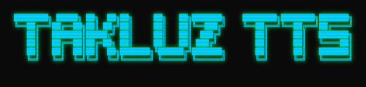
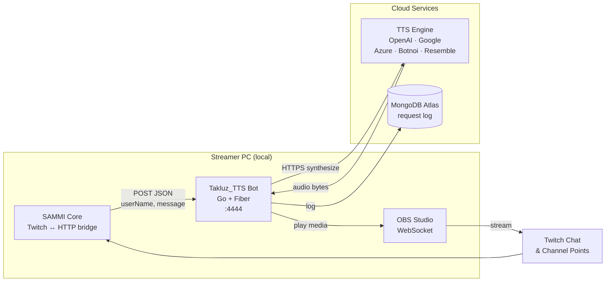

# Takluz_TTS

  

  
  
  
  
  
  

> Twitch channel-points TTS bot — gives high-loyalty viewers the same voice on stream as Bits donors, no payment required.

## What it is

Takluz_TTS turns Twitch channel-point redemptions and chat commands into spoken audio on stream — **Bits not required**. It bridges [SAMMI Core](https://sammi.solutions/) to five pluggable TTS engines (OpenAI, Google Cloud, Azure, Botnoi, Resemble AI) and plays the synthesized audio through OBS Studio's media controls, all from a Windows PC.

## Demo

## Architecture

## Why this exists

Off-the-shelf Twitch TTS bots gate voices behind Bits — paying for voice time. That ties participation to wallet, not engagement. A viewer who's been in chat for 200 days earns the same voice slot as someone who tipped once.

Takluz_TTS swaps Bits for **channel points** — Twitch-native currency every viewer already earns for free, just by being active. Now the high-loyalty viewer who never tips can speak on stream exactly like the big tipper. Streamer pays nothing extra; the platform's own engagement metrics decide who talks.

## Tech stack

- **Go 1.23** + Fiber v2 — HTTP server on `localhost:4444`
- **SAMMI Core** — Twitch ↔ HTTP bridge (handles channel points + chat commands)
- **OBS WebSocket** (`andreykaipov/goobs`) — plays synthesized audio into the stream
- **MongoDB Atlas** — logs every request for moderation
- **PyInstaller** — `setting.exe` config GUI for credentials and OBS password

## Quickstart

1. Install [SAMMI Core](https://sammi.solutions/) and [OBS Studio](https://obsproject.com/).
2. Enable OBS WebSocket server (Tools → WebSockets Server Settings → Enable).
3. Run `setting.exe`, paste your TTS provider API key and OBS WebSocket password.
4. Import the matching SAMMI deck JSON from `sammi/` (one per TTS engine).
5. Run `takluz_tts.exe`. The bot listens on `localhost:4444`.

## Supported TTS engines

| Engine | Strongest for | Notes |
|---|---|---|
| OpenAI | English, high quality | `tts-1` / `gpt-4o-mini-tts` |
| Google Cloud | Wide language coverage | Multi-voice |
| Botnoi | Thai pronunciation | Local speech team |
| Azure | Enterprise reliability | SSML support |
| Resemble AI | Custom cloned voices | Voice UUID required |

## Design choices worth flagging

- **Pluggable TTS** — adding an engine is one route handler (`/new_engine`) plus one config struct. The existing five were added without touching each other.
- **No vendor coupling** — OBS, Twitch, and every TTS provider sit behind small interfaces (`goobs`, Fiber routes, sound package). Each can be swapped.
- **Local-first** — the bot runs on the streamer's PC. Nothing is proxied through a third party.
- **Channel points over Bits** — chose the Twitch-native free path over the paid path because it lowers the bar for casual viewers and rewards loyalty.

## Contact

Discord: [takluz](https://discord.gg/whnxWt4NKj)
